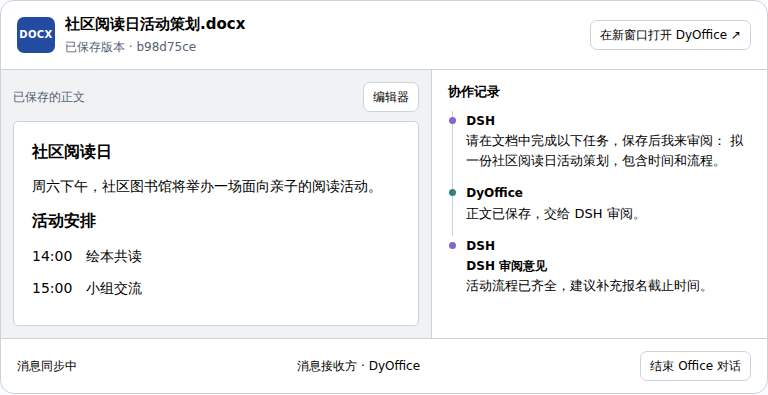

# DSH DyOffice

在 DSH 聊天里说「帮我写一份读书会活动策划，保存成 Word」。收到文档链接后，点「在聊天中打开」即可在对话里编辑正文；点击文件名可以在独立窗口打开同一份文档。频道已授权免登录编辑且允许嵌入当前 DSH 地址时，两边的文字修改会自动同步。写入 DOCX 由持有保存租约的窗口完成。未允许嵌入时，聊天里会提供新窗口入口。

执行 `/dyoffice word 创建一个活动策划` 后，如果已启用网页嵌入，任务消息会直接显示 DyOffice 文档页面，以及 DSH 交办、DyOffice 交付和后续审阅的记录。文档页面可直接点击和编辑。点击「正文」查看文字摘录，点击「Office 网页」切回编辑器；也可点击「在新窗口打开 DyOffice」，在独立窗口中编辑同一份文件。底部显示同步状态和消息接收方。XLSX、PPTX、PDF 使用相同入口。



在聊天中运行应用的来源由「全局配置 → 跨域嵌入」管理，默认允许 localhost:3080 和 127.0.0.1:3080；需在同一浏览器登录 DyOffice。未允许嵌入时，点击新窗口入口启动 Office。历史消息保留正文摘录和打开原文入口；只有当前任务在聊天里运行原生应用。

1. 使用本仓库版本启动 DyOffice，依照[频道与后台任务说明](../../docs/dyoffice/assistant-background.md)开启后台执行。
2. 安装插件并配置授权 Token 文件路径；DyOffice 地址可配置为默认值，也可在授权提示中填写。已有本地源码时，可把下面的 `dsh` 替换为 `node ~/pros/dsh/apps/cli/lib/bin.js`。

   ```bash
   cd ~/pros/DyOffice/integrations/dsh-dyoffice
   export DSH_DYOFFICE_MEMBER_FILE=~/.dsh/dyoffice-token.json
   mkdir -p ~/.dsh
   dsh plugin --profile web add "link:$PWD"
   dsh web
   ```

3. 在 DSH 聊天里直接说「帮我写一份活动策划」即可撰写、创建并保存 Word 文档。也可以说「打开当前频道文档」或「建一个叫活动预算的空白 Excel 表」。插件会返回文档链接。启用免登录编辑后，从 DSH 点击链接即可在新窗口编辑并保存。
4. 首次连接时，在 DyOffice 的「频道分享」生成授权 Token，点击「复制 DSH 插件授权码」，将它粘贴到插件的授权提示中。授权码包含服务地址，旧 Token 仍可配合服务地址使用。不要把授权码发到聊天。连接成功后，等待授权的任务会继续。

要启用免登录编辑，在「频道分享」勾选「允许在 DSH 中免登录编辑文档」，生成新授权码并在插件中更新。要创建文件，再勾选创建权限。编辑只限频道绑定文档或这一授权创建的文件；在 DSH 中再次点击链接可续开，撤销授权即停止访问。旧授权码仍可使用原有功能。

Token 受签发者的 DyOffice 登录会话约束。登录会话过期或注销后，需要在 DyOffice 重新生成 Token 并连接。

要创建文件，在频道分享中勾选「允许 DSH 在我的工作区创建新文档」再生成 Token。四种格式用法相同：

- `/dyoffice word 创建一个活动策划`
- `/dyoffice xlsx 创建一个活动预算表`
- `/dyoffice pptx 创建一个项目汇报`
- `/dyoffice pdf 创建一个活动通知`

要传一个 DSH Skill，写成 `/dyoffice word --skill=events 创建活动策划`，把 `events` 换成 DSH 中的 Skill 名称。四种格式都支持。Office 助手收到本次任务的 Skill 正文（最多 24 KB），不会导入脚本、关联文件或权限，也不会把 Skill 正文写进共享聊天记录。

DSH 将需求交给当前文档的 DyOffice 助手。工具由 Office 助手调用，聊天内的小窗口直接显示该应用；下面的对话显示撰写、保存和审阅状态。助手保存新版后，DSH 才会审阅，意见显示在双方对话中。仅需空文件时可用 `/dyoffice xlsx 创建空白文件 demo`，其他格式同理。

`DSH_DYOFFICE_ORIGIN` 可设置为默认服务源地址；同机开发可使用 localhost 或环回 IP 的 HTTP 地址。一个 DSH Web 进程使用一个频道。Token 和所填 URL 仅由 DSH 后端读取，面板只在 DSH 所有者会话显示数据。

支持 `conversation/route-message` 的 DSH Web 会把协作交接和审阅显示在对应的 `/dyoffice` 对话消息里。正文保存后，在同一个 DSH 会话输入普通消息即可继续问 DyOffice 助手；DSH 把消息原文转入当前文档的 Office 助手。首轮和追问都出现在该助手的原生对话中，后续消息沿用同一段对话历史。同一 DSH 页面里切换会话不会关闭正在运行的 Office 窗口；关闭或刷新整个页面会中断其中的任务。点「结束 Office 对话」可切回 DSH。这个会话接续保存在当前浏览器页面，刷新页面后不会自动恢复。可直接要求修改当前文档；写入使用 Office 原生文档工具并检查保存结果。

同一 DyOffice 账号在另一浏览器打开同一文档，可在 Office 助手面板看到新的提问、流式回答和已保存的问答。旁观窗口不会重复发起模型请求。工具参数、工具输出和 DSH 自己的审阅回执不写入这份共享记录。

在另一浏览器打开同一份 Word 时，两边可以同时输入正文。编辑器合并正文修改，由持有保存租约的窗口提交 DOCX。请使用同一份文件链接；下载后重新上传、或打开同名副本，都属于不同文档。这个功能同步 Word 正文；页眉等文档属性以及 XLSX、PPTX、PDF 不使用这套并发合并机制。

也可在 DSH Web 的 `cordis.patch.yml` 中为插件指定地址和 Token 文件路径。授权 Token 只保存在 DSH 服务端，文件权限为仅当前用户可读写；侧栏不会把 Token 放入 URL 或聊天内容。

```yaml
- id: dyoffice-preview
  config:
    memberFile: /absolute/path/to/dyoffice-token.json
```

Office 跨域嵌入来源可在「全局配置 → 跨域嵌入」设置，每行一个 HTTP(S) origin，保存后生效。默认允许 `http://localhost:3080` 和 `http://127.0.0.1:3080`；清空列表关闭跨域嵌入。仅显式带 `dshEmbed=1` 的 Office 页面使用此设置，登录和文档权限保持有效。
